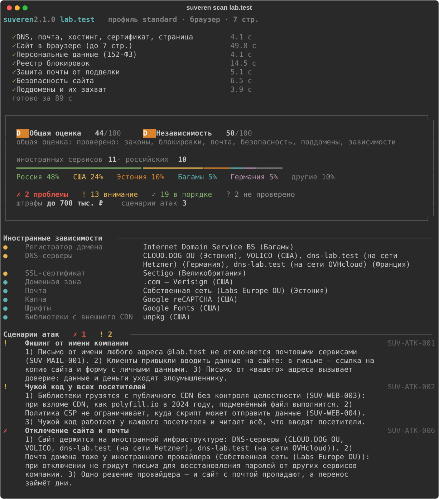
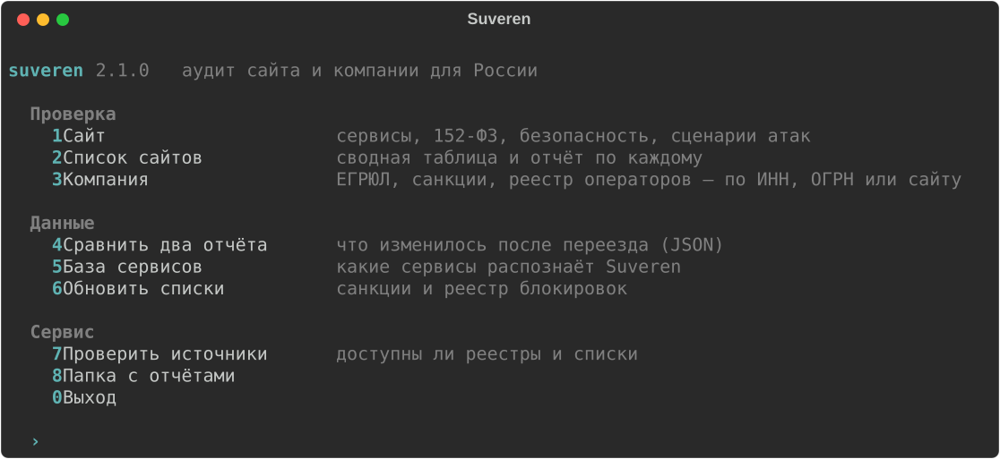
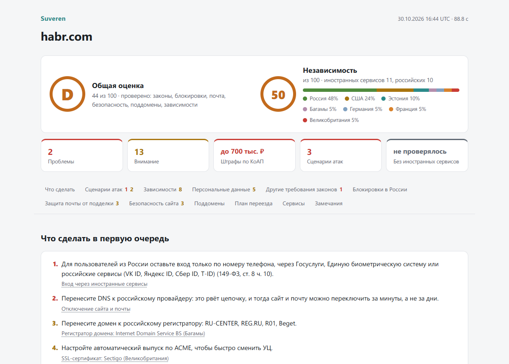
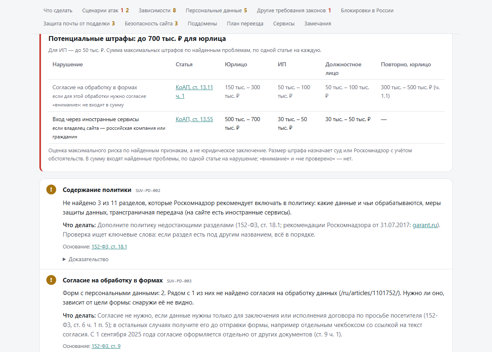
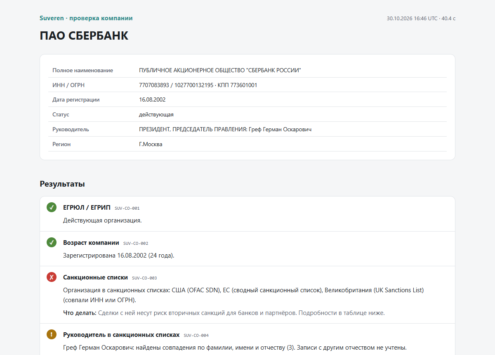
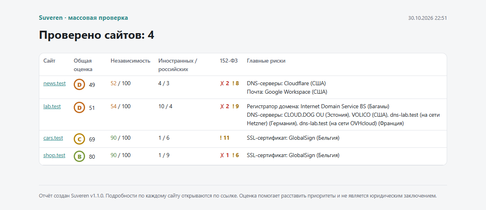

<div align="center">

<picture>
  <source media="(prefers-color-scheme: dark)" srcset="docs/logo-dark.png">
  
</picture>

**Website and company audit for doing business in Russia**<br>
foreign dependencies · personal-data law (152-FZ) · blocking · mail spoofing · web security · company registry and sanctions

[](https://github.com/marsilid/suveren/releases/latest)
[](https://pypi.org/project/suveren/)
[](https://github.com/marsilid/suveren/actions/workflows/ci.yml)


[Русская версия](README.md)

</div>

Give it a website and in about a minute you get a report: what on the site depends on foreign
services, which legal requirements are broken and what fine that can mean, whether mail can be
forged in the company's name, and what to fix first. Every finding comes with its evidence: a DNS
record, a response header, a quote from the privacy policy, a script address.

The tool, its reports and the guide are in Russian: the audience is Russian businesses.



<sub>The pictures show made-up sites in the reserved `.test` zone: real audit data with names,
addresses and IPs replaced so as not to expose other companies.</sub>

## Quick start

**Windows.** Download `Suveren.exe` from the
[latest release](https://github.com/marsilid/suveren/releases/latest) and run it: a menu opens, no
command line and no Python needed. Windows may warn about an unknown publisher — "More info" →
"Run anyway".

**Any system** (Python 3.11+):

```bash
pip install "suveren[browser]"
suveren scan example.ru
```

If pip says `Could not find a version that satisfies the requirement suveren`
("from versions: none"), your Python is older than 3.11: check `python --version` and upgrade
it, or download the ready exe.

<details>
<summary>Other ways: from source and Docker</summary>

From source, `Suveren.bat` opens the same menu: download the repository (Code → Download ZIP),
unpack it and run the batch file — on first launch it installs everything it needs.

```bash
docker build -t suveren https://github.com/marsilid/suveren.git
docker run --rm -v "$PWD:/work" suveren scan example.ru
```



</details>

## What it checks

- **What breaks with the next round of sanctions?** DNS, mail, hosting, CDN, site builder,
  registrar, certificate, scripts and widgets. An independence grade from A to F and a migration
  plan.
- **Does the site comply with 152-FZ?** The privacy policy and its contents, consent in forms,
  cookies, cross-border transfer, the register of personal-data operators, Google and Apple
  sign-in, Instagram and Facebook links without the note that Meta is banned. The total of
  possible administrative fines.
- **Does the site open in Russia?** The domain and IPs in the block list, blocked services on the
  pages.
- **Can mail be forged in the company's name?** SPF, DMARC, DKIM, MTA-STS and a plain answer:
  yes, partly or no.
- **Are there forgotten subdomains that can be taken over?**
- **Whose code runs on the site?** Third-party and abandoned scripts, vulnerable libraries, keys
  in the code, security headers, cookies, TLS, CAA and DNSSEC.
- **Who are we dealing with?** The company in the state register (EGRUL), US, EU, UK and UN
  sanctions lists, the Rosfinmonitoring list.

About 70 checks with permanent IDs ([list](docs/checks.md)) and a database of 300+ services.
Findings from different sections combine into attack scenarios: "mail can be forged" + "the site
takes payments" = phishing in the company's name.

## The report

The report is saved to `reports/` and opens in the browser. On top: grades, fines and what to fix
first; under each problem — the evidence, the article of law and how to fix it. It can also be
saved as PDF or Word, as a one-page summary for management, or under your studio's brand.

<picture>
  <source media="(prefers-color-scheme: dark)" srcset="docs/report-dark.png">
  
</picture>

<details>
<summary>The 152-FZ section, the company check and a summary over a list of sites</summary>

<picture>
  <source media="(prefers-color-scheme: dark)" srcset="docs/compliance-dark.png">
  
</picture>

<picture>
  <source media="(prefers-color-scheme: dark)" srcset="docs/company-dark.png">
  
</picture>

<picture>
  <source media="(prefers-color-scheme: dark)" srcset="docs/batch-dark.png">
  
</picture>

</details>

## Main commands

```bash
suveren scan site.ru                    # regular audit, about 20 seconds
suveren scan site.ru --profile deep     # deep: browser, up to 12 pages, service cut-off
suveren scan site.ru --pdf report.pdf   # plus PDF; --docx for Word, --summary for management
suveren company 7707083893              # a company by INN, OGRN or website
suveren batch sites.txt                 # a list of sites: summary table, CSV, a report each
suveren watch sites.txt --every 24h     # watch sites; changes can go to Telegram
suveren research sites.txt             # a study: only the share of sites with each finding
suveren scan site.ru -v                 # every network step with timings: see where it hangs
suveren scan site.ru --dkim-selector ew # also check your own DKIM selector, not just common ones
```

All commands and options are in the [guide](docs/guide.md#все-команды) (in Russian) and in
`suveren --help` and `suveren scan --help`.

## What Suveren does to the site

Mostly Suveren looks at what any visitor sees: public DNS records, open registers and the site's
pages. No port scanning, no password guessing.

- **`company` by INN or OGRN** never contacts the site: only the state register, other registers
  and sanctions lists. Given a website, it opens the home page to find the INN there.
- **`scan`** opens the home page and up to 6 inner pages. In two places it probes: it tries the
  outdated TLS 1.0 and 1.1 and opens pages of subdomains that point to external services. The
  site sees your IP, as with a normal visit.
- **`--browser` and `--profile deep`** open pages in a browser, so the site's JavaScript runs on
  your computer. The browser is sandboxed and cannot reach your network or download files.
- **`--own-site`** goes deeper on **your own** site: `.git` and `.env` files, TLS ciphers, mail
  servers, and with `--form-leaks` data leaking from forms. It runs only after ownership is
  proven (`suveren verify`).

For every check, [docs/checks.md](docs/checks.md) says what it does to the site and what the
person running it risks. Where data goes with `--dns ru` is in the
[guide](docs/guide.md#параметры-проверки); the risks of plugins are in
[docs/plugins.md](docs/plugins.md).

## In CI

```bash
suveren scan example.ru --no-open --sarif suveren.sarif --fail-on fail
```

SARIF is read by GitHub and GitLab code scanning and DefectDojo. A finding you decided not to fix
yet can be accepted in `.suveren-ignore` with a reason, an author and a deadline: it stays in the
report but does not fail the build, and counts again after the deadline. More in the
[guide](docs/guide.md#ci-и-другие-инструменты).

## Data sources and limitations

All sources are open and free, no API keys: DNS, RDAP and WHOIS, the state register, the register
of personal-data operators, the block list export by antifilter.download, certificate
transparency logs, sanctions lists, the retire.js vulnerability database. `suveren doctor` checks
that they all answer.

The report helps set priorities and **is not a legal opinion**: every 152-FZ check links to the
article of law. Where a check could not be done, Suveren says "not checked" rather than a false
"OK". All limitations are in the [guide](docs/guide.md#ограничения).

## Contributing

Adding a service to the database needs no programming: it is the data file
[`services.json`](src/suveren/data/services.json), described in the
[guide](docs/guide.md#как-добавить-сервис-в-базу). Or just open an "Add a service" issue. How the
code is organised and how to run the tests is in [CONTRIBUTING.md](CONTRIBUTING.md);
vulnerabilities go by the rules in [SECURITY.md](SECURITY.md).

## License

[GNU AGPL-3.0](LICENSE) or later, from version 1.1: the code is open, and any modified version,
including one run as a service, must be open too. A commercial license is available for closed
products and SaaS — see [COPYRIGHT](COPYRIGHT). Versions up to 1.0.x remain under MIT.

Related project: [ReconLens](https://github.com/marsilid/reconlens) — passive OSINT
reconnaissance of a domain with a security score.
