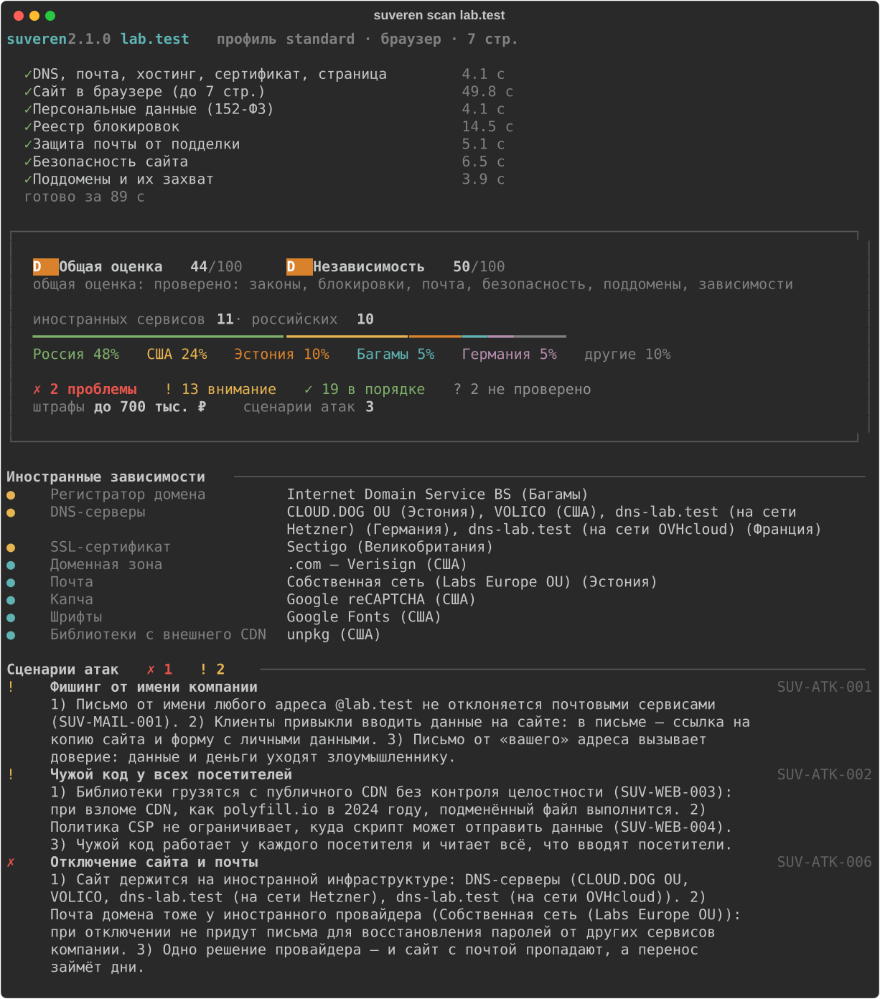
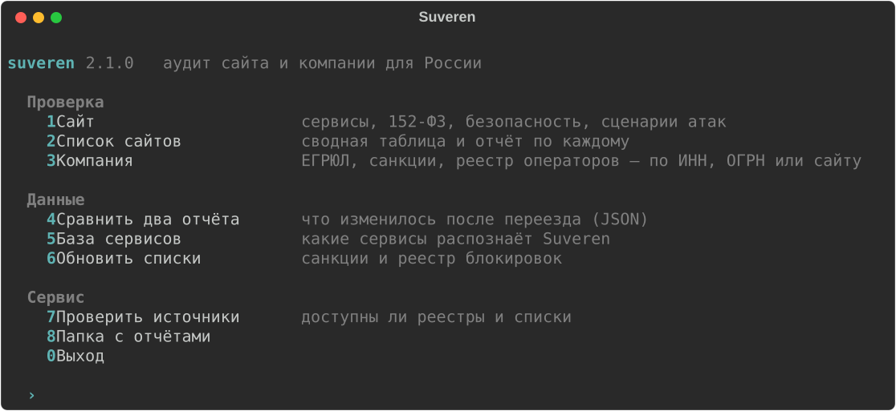
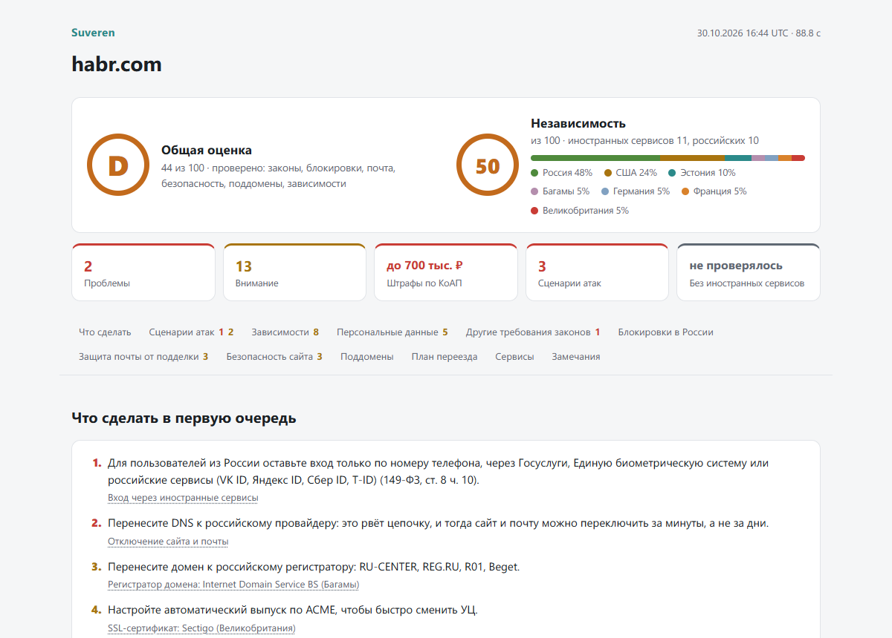
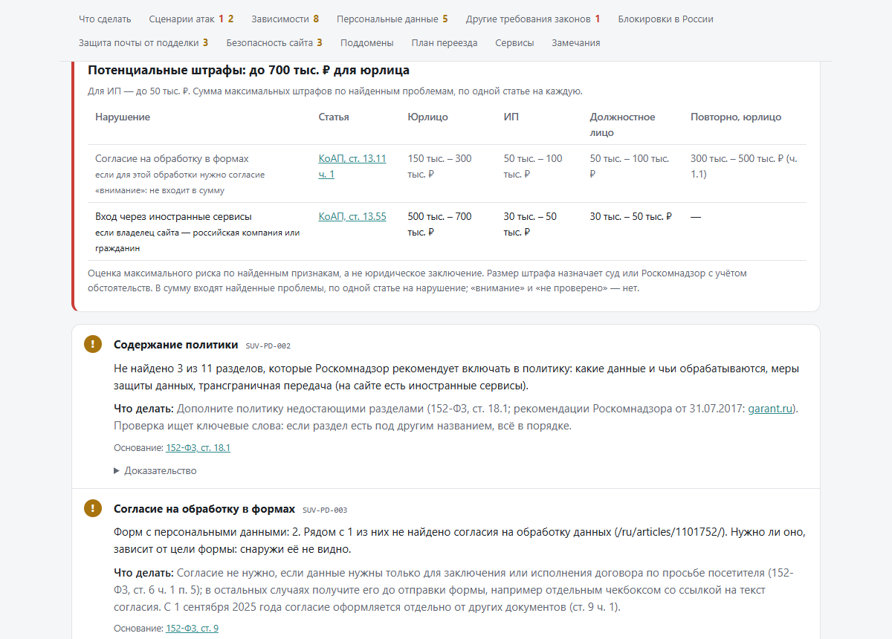
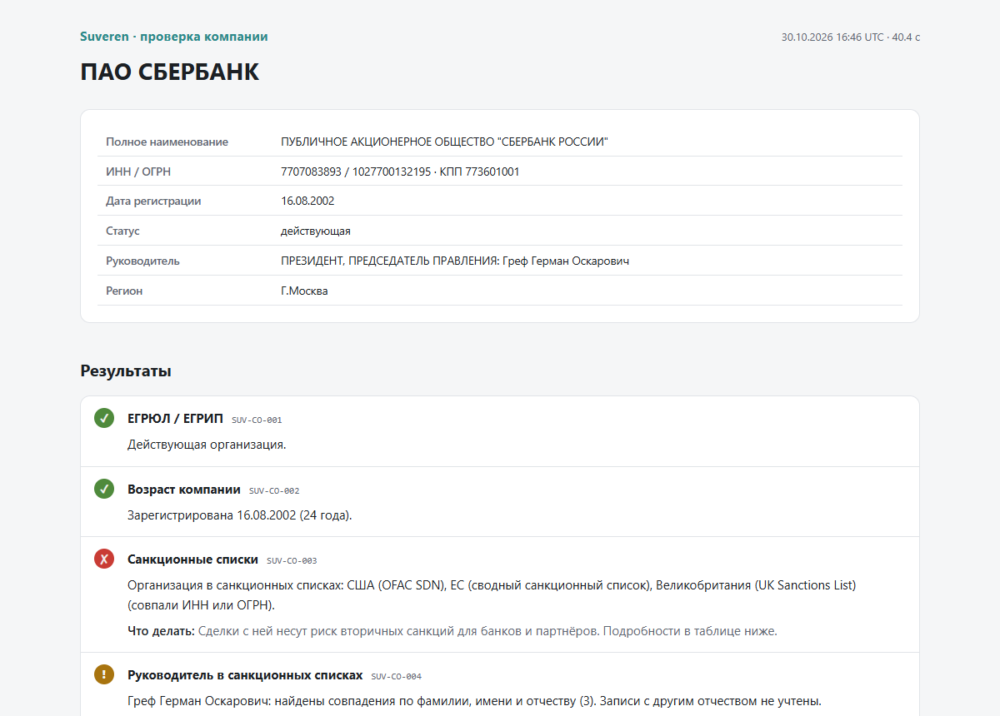
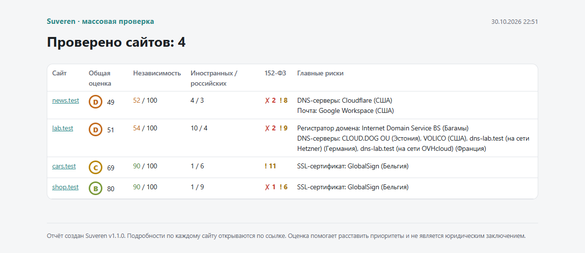

<div align="center">

<picture>
  <source media="(prefers-color-scheme: dark)" srcset="docs/logo-dark.png">
  
</picture>

**Проверка сайта и компании для работы в России**<br>
иностранные сервисы · 152-ФЗ · блокировки · защита почты · безопасность · ЕГРЮЛ и санкции

[](https://github.com/marsilid/suveren/releases/latest)
[](https://pypi.org/project/suveren/)
[](https://github.com/marsilid/suveren/actions/workflows/ci.yml)


[English version](README.en.md)

</div>

Укажите адрес сайта, и через минуту у вас будет отчёт: что на сайте держится на иностранных
сервисах, какие требования закона нарушены и какой штраф за это грозит, можно ли подделать
письмо от имени компании и что исправить в первую очередь. Каждый вывод подкреплён
доказательством: DNS-записью, заголовком ответа, цитатой из политики, адресом скрипта.



<sub>На картинках — выдуманные сайты в зарезервированной зоне `.test`: это данные настоящих
проверок, в которых имена, адреса и IP заменены, чтобы не показывать чужие компании.</sub>

## Быстрый старт

**Windows.** Скачайте `Suveren.exe` со страницы
[последнего релиза](https://github.com/marsilid/suveren/releases/latest) и запустите: откроется
меню, командную строку знать не нужно, Python не нужен. Windows может предупредить о неизвестном
издателе — «Подробнее» → «Выполнить в любом случае».

**Любая система** (Python 3.11+):

```bash
pip install "suveren[browser]"
suveren scan example.ru
```

<details>
<summary>Другие способы: из исходного кода и Docker</summary>

Из исходного кода меню открывает `Suveren.bat`: скачайте репозиторий (Code → Download ZIP),
распакуйте и запустите батник — при первом запуске он сам установит всё нужное.

```bash
docker build -t suveren https://github.com/marsilid/suveren.git
docker run --rm -v "$PWD:/work" suveren scan example.ru
```



</details>

## Что проверяет

- **Что отвалится при следующей волне санкций?** DNS, почта, хостинг, CDN, конструктор сайта,
  регистратор, сертификат, скрипты и виджеты. Оценка независимости от A до F и план переезда.
- **Соблюдает ли сайт 152-ФЗ?** Политика и её содержание, согласия в формах, cookies,
  трансграничная передача, реестр операторов ПДн, вход через Google и Apple, ссылки на Instagram
  и Facebook без пометки о запрете Meta. Сумма возможных штрафов по КоАП.
- **Открывается ли сайт в России?** Домен и IP-адреса в реестре блокировок, заблокированные
  сервисы на страницах.
- **Можно ли подделать письмо от имени компании?** SPF, DMARC, DKIM, MTA-STS и простой ответ: да,
  частично или нет.
- **Нет ли забытых поддоменов, которые можно захватить?**
- **Чей код выполняется на сайте?** Сторонние и брошенные скрипты, уязвимые библиотеки, ключи в
  коде, заголовки безопасности, cookies, TLS, CAA и DNSSEC.
- **С кем мы имеем дело?** Компания в ЕГРЮЛ, санкционные списки США, ЕС, Великобритании и ООН,
  перечень Росфинмониторинга.

Около 70 проверок с постоянными ID ([список](docs/checks.md)) и база из 300 с лишним сервисов.
Находки из разных разделов собираются в сценарии атак: «почту можно подделать» + «на сайте есть
оплата» = фишинг от имени компании.

Кому пригодится: владельцам бизнеса и ИТ-директорам, веб-студиям, юристам и ответственным за
персональные данные, отделам закупок для проверки контрагентов.

## Отчёт

Отчёт сохраняется в `reports/` и сам открывается в браузере. Сверху — оценки, штрафы и что
сделать в первую очередь; под каждой проблемой — доказательство, статья закона и как исправить.
Можно сохранить ещё в PDF или Word, сделать сводку на одну страницу для руководителя или
оформить отчёт под брендом своей студии.

<picture>
  <source media="(prefers-color-scheme: dark)" srcset="docs/report-dark.png">
  
</picture>

<details>
<summary>Раздел 152-ФЗ, проверка компании и сводка по списку сайтов</summary>

<picture>
  <source media="(prefers-color-scheme: dark)" srcset="docs/compliance-dark.png">
  
</picture>

<picture>
  <source media="(prefers-color-scheme: dark)" srcset="docs/company-dark.png">
  
</picture>

<picture>
  <source media="(prefers-color-scheme: dark)" srcset="docs/batch-dark.png">
  
</picture>

</details>

## Главные команды

```bash
suveren scan сайт.ru                    # обычная проверка, около 20 секунд
suveren scan сайт.ru --profile deep     # глубокая: браузер, до 12 страниц, отключение сервисов
suveren scan сайт.ru --pdf отчёт.pdf    # то же и PDF; --docx — Word, --summary — для руководителя
suveren company 7707083893              # компания по ИНН, ОГРН или адресу сайта
suveren batch sites.txt                 # список сайтов: сводная таблица, CSV и отчёт по каждому
suveren watch sites.txt --every 24h     # следить за сайтами; изменения можно получать в Telegram
suveren research sites.txt             # исследование: только доли сайтов с каждой находкой
```

Все команды и параметры — в [руководстве](docs/guide.md#все-команды), а также в
`suveren --help` и `suveren scan --help`.

## Что Suveren делает с сайтом

Suveren в основном смотрит то же, что любой посетитель: публичные DNS-записи, открытые реестры и
страницы сайта. Никакого сканирования портов и подбора паролей.

- **`company` по ИНН или ОГРН** к сайту не обращается: только ЕГРЮЛ, реестры и санкционные
  списки. По адресу сайта он открывает главную страницу, чтобы найти на ней ИНН.
- **`scan`** открывает главную и до 6 внутренних страниц. В двух местах он прощупывает: пробует
  соединиться по устаревшим TLS 1.0 и 1.1 и открывает страницы поддоменов, которые ведут на
  внешние сервисы. Сайт видит ваш IP, как при обычном заходе.
- **`--browser` и `--profile deep`** открывают страницы в браузере, и на вашем компьютере
  выполняется JavaScript сайта. Браузер работает в песочнице, ему закрыты адреса вашей сети и
  загрузка файлов.
- **`--own-site`** глубже проверяет **свой** сайт: служебные файлы `.git` и `.env`, шифры TLS,
  почтовые серверы, а с `--form-leaks` — утечки данных из форм. Запускается только после
  подтверждения владения (`suveren verify`).

У каждой проверки в [docs/checks.md](docs/checks.md) указано, что она делает с сайтом и чем
рискует тот, кто её запускает. Куда уходят данные при `--dns ru` — в
[руководстве](docs/guide.md#параметры-проверки), чем рискуют плагины — в [docs/plugins.md](docs/plugins.md).

## Для CI

```bash
suveren scan example.ru --no-open --sarif suveren.sarif --fail-on fail
```

SARIF читают GitHub и GitLab code scanning и DefectDojo. Находку, которую решили пока не
исправлять, можно принять в `.suveren-ignore` с причиной, автором и сроком: она остаётся в
отчёте, но не валит сборку, а после срока снова считается. Подробнее — в
[руководстве](docs/guide.md#ci-и-другие-инструменты).

## Источники данных и ограничения

Все источники открытые и бесплатные, ключи API не нужны: DNS, RDAP и WHOIS, ЕГРЮЛ, реестр
операторов ПДн, выгрузка реестра блокировок от antifilter.download, журналы сертификатов,
санкционные списки, база уязвимых библиотек retire.js. `suveren doctor` проверяет, что все они
отвечают.

Отчёт помогает расставить приоритеты и **не является юридическим заключением**: у каждой
проверки 152-ФЗ указана статья закона со ссылкой на текст. Где проверить не удалось, Suveren
пишет «не проверено», а не ложное «в порядке». Все ограничения — в
[руководстве](docs/guide.md#ограничения).

## Участие

Чтобы добавить сервис в базу, программировать не нужно: это файл
[`services.json`](src/suveren/data/services.json), как его заполнить — в
[руководстве](docs/guide.md#как-добавить-сервис-в-базу). Можно и просто открыть issue
«Добавить сервис». Как устроен код и как запускать тесты — в [CONTRIBUTING.md](CONTRIBUTING.md),
об уязвимостях — по правилам [SECURITY.md](SECURITY.md).

## Лицензия

[GNU AGPL-3.0](LICENSE) или более поздняя, начиная с версии 1.1: код открыт, и любая изменённая
версия, в том числе работающая как сервис, тоже должна быть открыта. Для закрытых продуктов и
SaaS есть коммерческая лицензия — подробности в [COPYRIGHT](COPYRIGHT). Версии до 1.0.x остаются
под MIT.

Связанный проект: [ReconLens](https://github.com/marsilid/reconlens) — пассивная OSINT-разведка
домена с оценкой безопасности.
