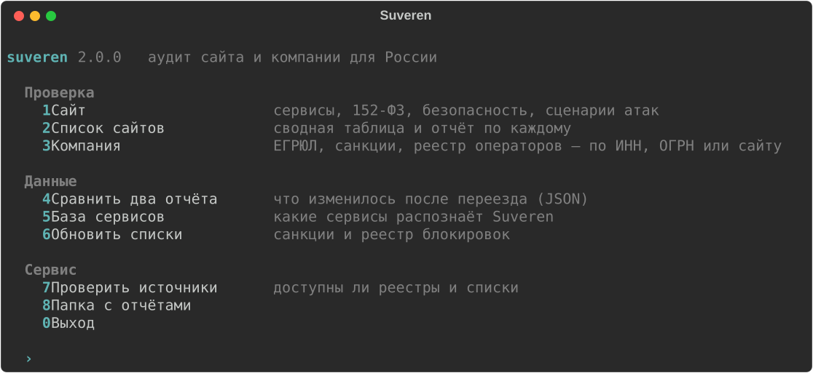
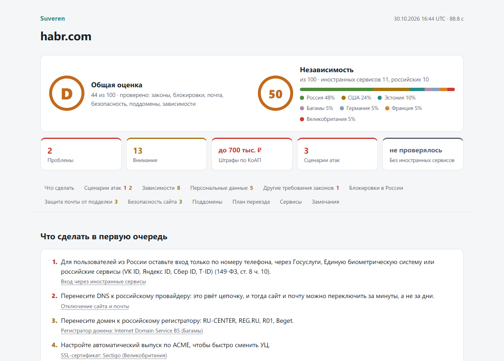
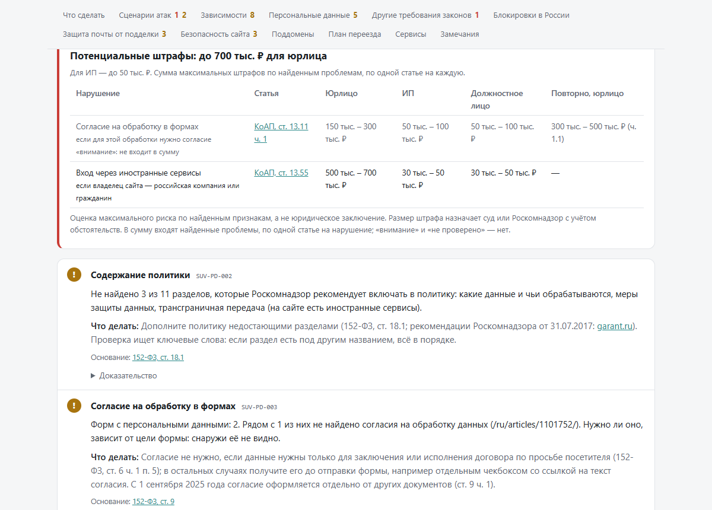
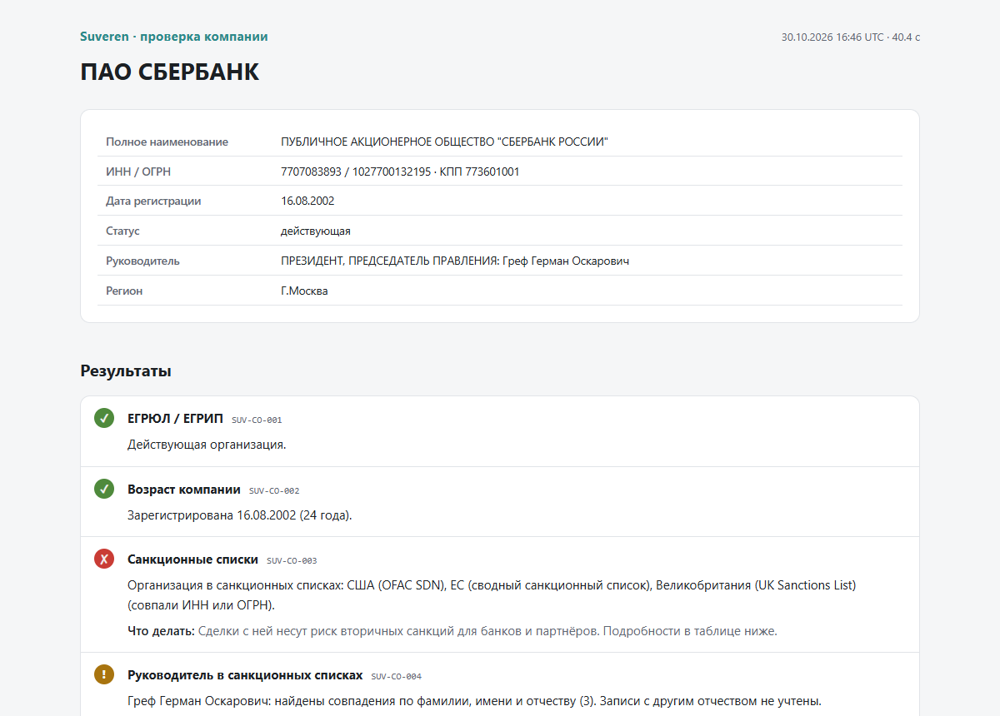
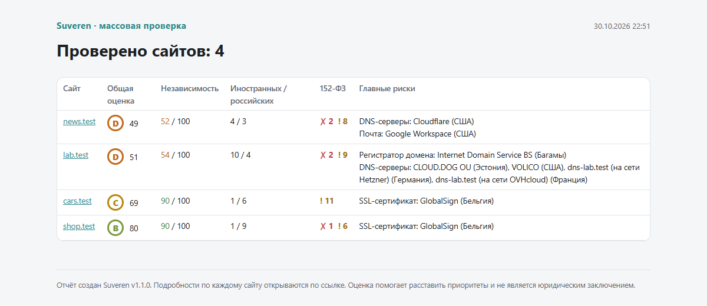

<div align="center">

# Suveren

**Проверка сайта и компании для работы в России**<br>
иностранные сервисы · 152-ФЗ · блокировки · защита почты · безопасность · ЕГРЮЛ и санкции

[](https://github.com/marsilid/suveren/actions/workflows/ci.yml)


[English version](README.en.md)

</div>

Укажите адрес сайта, и через минуту у вас будет отчёт: что на сайте держится на иностранных
сервисах, какие требования закона нарушены и какой штраф за это грозит, можно ли подделать
письмо от имени компании и что исправить в первую очередь. Каждый вывод подкреплён
доказательством: DNS-записью, заголовком ответа, цитатой из политики, адресом скрипта.

Suveren в основном смотрит то же, что любой посетитель: публичные DNS-записи, открытые реестры
и страницы сайта. Никакого сканирования портов, подбора паролей и поиска открытых `.git` или
`.env`. Что именно каждая проверка делает с сайтом и чем рискуете вы, сказано
[ниже](#что-suveren-делает-с-сайтом).


<sub>На картинках — выдуманные сайты в зарезервированной зоне `.test`: это данные настоящих
проверок, в которых имена, адреса и IP заменены, чтобы не показывать чужие компании.</sub>

## Что проверяет

| | Вопрос | Что смотрится |
|---|---|---|
| 🌍 | **Что отвалится при следующей волне санкций?** | DNS, почта, хостинг, CDN, конструктор сайта, регистратор, SSL-сертификат, скрипты и виджеты. Оценка независимости от **A** до **F** и план переезда на российские сервисы |
| ⚖️ | **Соблюдает ли сайт 152-ФЗ?** | политика и её содержание, согласия в формах, cookies, трансграничная передача, хранение данных в России, реестр операторов ПДн, вход через Google и Apple, рекомендательные технологии. Сумма возможных штрафов по КоАП |
| 🚫 | **Открывается ли сайт в России?** | домен и IP-адреса в выгрузке реестра блокировок Роскомнадзора (её публикует antifilter.download, не РКН), заблокированные сервисы на страницах |
| ✉️ | **Можно ли подделать письмо от имени компании?** | SPF, DMARC, DKIM и длина его ключа, MTA-STS и простой ответ: да, частично или нет |
| 🔓 | **Нет ли забытых поддоменов, которые можно захватить?** | поддомены из журналов сертификатов, ведущие на удалённые проекты в чужих сервисах |
| 🛡️ | **Чей код выполняется на сайте?** | сторонние и брошенные скрипты, уязвимые версии библиотек, ключи в коде, CSP, HSTS, cookies, TLS, CAA и DNSSEC |
| 🏢 | **С кем мы имеем дело?** | компания в ЕГРЮЛ, санкционные списки США, ЕС и Великобритании, реестр операторов ПДн |

Всего около 60 проверок, у каждой постоянный ID — их список в [docs/checks.md](docs/checks.md).
Находки из разных разделов собираются в **сценарии атак**: например, «почту можно подделать» +
«на сайте есть оплата» = фишинг от имени компании.

Кому пригодится: владельцам бизнеса и ИТ-директорам, веб-студиям для аудита сайтов клиентов,
юристам и ответственным за персональные данные, отделам закупок для проверки контрагентов.

## Что Suveren делает с сайтом

У каждой проверки две метки (они есть в [docs/checks.md](docs/checks.md) и в
`suveren checks ID`): что она делает с сайтом и чем рискует тот, кто её запускает.

| Запуск | С сайтом | Для вас |
|---|---|---|
| `suveren company` по ИНН или ОГРН | не обращается: только ЕГРЮЛ, реестр операторов ПДн РКН и санкционные списки | сайт вас не видит |
| `scan --profile quick` | только смотрит: главная страница и DNS | сайт видит ваш IP, как при обычном заходе |
| `scan` (по умолчанию) | смотрит главную и до 6 внутренних страниц, файл MTA-STS. **Прощупывает** в двух местах: пробует соединиться по устаревшим TLS 1.0 и 1.1 и открывает страницы поддоменов, которые ведут на внешние сервисы или на адреса облаков | сайт видит ваш IP; такие соединения могут попасть в журналы его защиты |
| `--browser`, `--cutoff`, `--profile deep` | то же, но страницы открывает браузер | **выполняется JavaScript сайта** в браузере на вашем компьютере. Браузеру закрыты адреса вашей сети и загрузка файлов, но скрипты работают как у посетителя |
| `--form-leaks` | **вводит тестовые данные** в формы и не отправляет их | выполняется JavaScript сайта. Только для своих сайтов или с согласия владельца |
| `--plugin файл.py` | что делает плагин | **код плагина работает с вашими правами**: запускайте только плагины, которым доверяете |

Проверки почты, реестр блокировок и журналы сертификатов к сайту не обращаются, но любой `scan`
всё равно открывает главную страницу: из неё собираются иностранные сервисы. `--dns ru` ведёт
DNS-запросы через Яндекс DNS, но это касается только DNS: имя сайта всё равно уходит в
журналы сертификатов (crt.sh, Cert Spotter, при проверке поддоменов) и в rdap.org, а IP-адреса —
в Team Cymru (США).

## Как запустить

### Windows: двойной клик

Скачайте `Suveren.exe` со страницы [Releases](https://github.com/marsilid/suveren/releases) и
запустите. Python не нужен. Windows может предупредить о неизвестном издателе: нажмите
«Подробнее» → «Выполнить в любом случае». Exe собирается из этого кода на GitHub Actions.

Откроется меню — командную строку знать не нужно:



Из исходного кода то же меню открывает `Suveren.bat`: скачайте репозиторий
(Code → Download ZIP), распакуйте и запустите батник. При первом запуске он сам установит
всё нужное (нужен [Python 3.11+](https://www.python.org/downloads/)).

### Любая система

```bash
pip install "suveren[browser]"
suveren scan example.ru
```

### Docker

```bash
docker build -t suveren https://github.com/marsilid/suveren.git
docker run --rm -v "$PWD:/work" suveren scan example.ru
```

## Отчёт

Отчёт сохраняется в папку `reports/` и сам открывается в браузере. Сверху — оценки, сумма
возможных штрафов и что сделать в первую очередь; под каждой проблемой — доказательство,
статья закона и как исправить.

<picture>
  <source media="(prefers-color-scheme: dark)" srcset="docs/report-dark.png">
  
</picture>

Раздел 152-ФЗ: каждая проверка со ссылкой на статью закона и возможным штрафом.

<picture>
  <source media="(prefers-color-scheme: dark)" srcset="docs/compliance-dark.png">
  
</picture>

## Команды

| Команда | Что делает |
|---|---|
| `suveren scan сайт.ru` | полная проверка сайта |
| `suveren batch sites.txt` | проверка списка сайтов: сводная таблица, CSV и отчёт по каждому |
| `suveren company <ИНН, ОГРН или сайт>` | ЕГРЮЛ, санкционные списки, реестр операторов ПДн |
| `suveren diff old.json new.json` | что изменилось между двумя проверками |
| `suveren checks [ID или тег]` | все проверки с ID и тегами |
| `suveren services [фильтр]` | база распознаваемых сервисов |
| `suveren update` | скачать свежие санкционные списки и реестр блокировок |
| `suveren doctor` | проверить, что все источники данных отвечают |
| `suveren audit reports/` | не противоречат ли отчёты сами себе |
| `suveren unknown` | внешние домены, которых нет в базе сервисов |
| `suveren menu` | меню (то же, что двойной клик по exe) |

Главные параметры `scan`:

| Параметр | Что делает |
|---|---|
| `--browser`, `-b` | открыть сайт в браузере (Edge или Chrome): видны скрипты, которые подгружаются динамически |
| `--profile quick\|standard\|deep` | `quick` — только иностранные сервисы; `standard` — все проверки (по умолчанию); `deep` — в браузере, до 12 страниц и с экспериментом `--cutoff` |
| `--checks mail,SUV-LAW-001` | только нужные проверки: по ID, префиксу или тегу |
| `--pages N` | сколько внутренних страниц проверить кроме главной (по умолчанию 6) |
| `--cutoff` | эксперимент: открыть сайт без иностранных сервисов и показать, что сломается |
| `--form-leaks` | эксперимент: уходят ли данные из форм сторонним сервисам до отправки (только для своих сайтов или с согласия владельца) |
| `--pdf файл.pdf` | сохранить отчёт ещё и в PDF |
| `--brand-name`, `--brand-logo`, `--brand-url` | отчёт под брендом вашей студии |
| `--json файл.json`, `--sarif файл.sarif` | результат для `diff`, CI и сканеров безопасности |
| `--since прошлый.json` | что изменилось с прошлой проверки |
| `--fail-under C`, `--fail-on fail` | ненулевой код выхода для CI |
| `--ignore файл` | принятые находки с причиной, автором и сроком (по умолчанию `.suveren-ignore`) |
| `--dns ru` | DNS-запросы только через Яндекс DNS. Остальные источники не меняются: имя сайта уходит в crt.sh, Cert Spotter и rdap.org, IP-адреса — в Team Cymru |
| `--no-mail`, `--no-security`, `--no-subdomains`, `--no-152fz`, `--no-blocklist` | пропустить раздел |

Полный список — `suveren scan --help`, подробности по каждой проверке —
в [руководстве](docs/guide.md).

## Проверка компании

```bash
suveren company 7707083893      # по ИНН
suveren company 1027700132195   # по ОГРН
suveren company example.ru      # ИНН будет найден на сайте
```

Данные из ЕГРЮЛ (статус, дата регистрации, руководитель), проверка компании и руководителя по
санкционным спискам США, ЕС и Великобритании, реестр операторов ПДн и сверка с сайтом.
Совпадения по ИНН и ОГРН точные, по названию и ФИО — возможные, их нужно проверить вручную.

<picture>
  <source media="(prefers-color-scheme: dark)" srcset="docs/company-dark.png">
  
</picture>

## Много сайтов сразу

Для веб-студий: файл со списком сайтов, по одному в строке.

```bash
suveren batch sites.txt --browser
```

В `reports/batch-…` появятся сводная таблица `index.html`, `summary.csv` для Excel и отчёт по
каждому сайту.

<picture>
  <source media="(prefers-color-scheme: dark)" srcset="docs/batch-dark.png">
  
</picture>

## Для CI

```bash
suveren scan example.ru --no-open --sarif suveren.sarif --fail-on fail
```

Находку, с которой решили жить, можно принять в файле `.suveren-ignore`: ID, сайт, срок,
автор и причина в строке. Она остаётся в отчёте, но не валит CI, а после срока снова считается.

SARIF читают GitHub и GitLab code scanning и DefectDojo. Коды выхода, формат JSON и плагины со
своими проверками описаны в [руководстве](docs/guide.md#ci-и-другие-инструменты) и
[docs/plugins.md](docs/plugins.md).

## Источники данных

Все источники открытые и бесплатные, ключи API не нужны: DNS, Team Cymru (сети IP-адресов),
RDAP и WHOIS, ЕГРЮЛ (ФНС), реестр операторов ПДн РКН, выгрузка реестра блокировок от antifilter.download, журналы
сертификатов (crt.sh, Cert Spotter), санкционные списки OFAC, ЕС и Великобритании, база
уязвимых библиотек retire.js, списки адресов облаков AWS, Google Cloud, Oracle и DigitalOcean.
`suveren doctor` проверяет, что все они отвечают; на GitHub эта проверка идёт каждый день.

## Ограничения

- Отчёт помогает расставить приоритеты и **не является юридическим заключением**. У каждой
  проверки 152-ФЗ указана статья закона со ссылкой на текст, чтобы вывод можно было перепроверить.
- Проверяются главная и до 6 внутренних страниц (`--pages`). Сервисы, которые есть только на
  остальных страницах, в отчёт могут не попасть.
- Если сайт закрыт от роботов даже в браузере, проверки по коду страницы получают статус
  «не проверено», а не ложное «в порядке».
- Если сайт за CDN, настоящий хостинг скрыт — Suveren об этом предупреждает.

## Участие

Чтобы добавить сервис в базу, программировать не нужно: это файл данных
[`services.json`](src/suveren/data/services.json) — как его заполнить, написано в
[руководстве](docs/guide.md#как-добавить-сервис-в-базу). Можно и просто открыть issue
«Добавить сервис». О найденных уязвимостях — по правилам из [SECURITY.md](SECURITY.md).

```bash
pip install -e ".[dev,browser]"
pytest
ruff check . && ruff format --check .
```

Тесты не ходят в сеть: ответы реестров и фрагменты списков лежат в `tests/fixtures`.

## Лицензия

Copyright © 2026 marsilid. Начиная с версии 1.1 — [GNU AGPL-3.0](LICENSE) или более поздняя:
код открыт, и любая изменённая версия, в том числе работающая как сервис, тоже должна быть
открыта. Для закрытых продуктов и SaaS есть коммерческая лицензия — подробности в
[COPYRIGHT](COPYRIGHT). Версии до 1.0.x были опубликованы под MIT и остаются под ней.

Связанный проект: [ReconLens](https://github.com/marsilid/reconlens) — пассивная OSINT-разведка
домена с оценкой безопасности.
