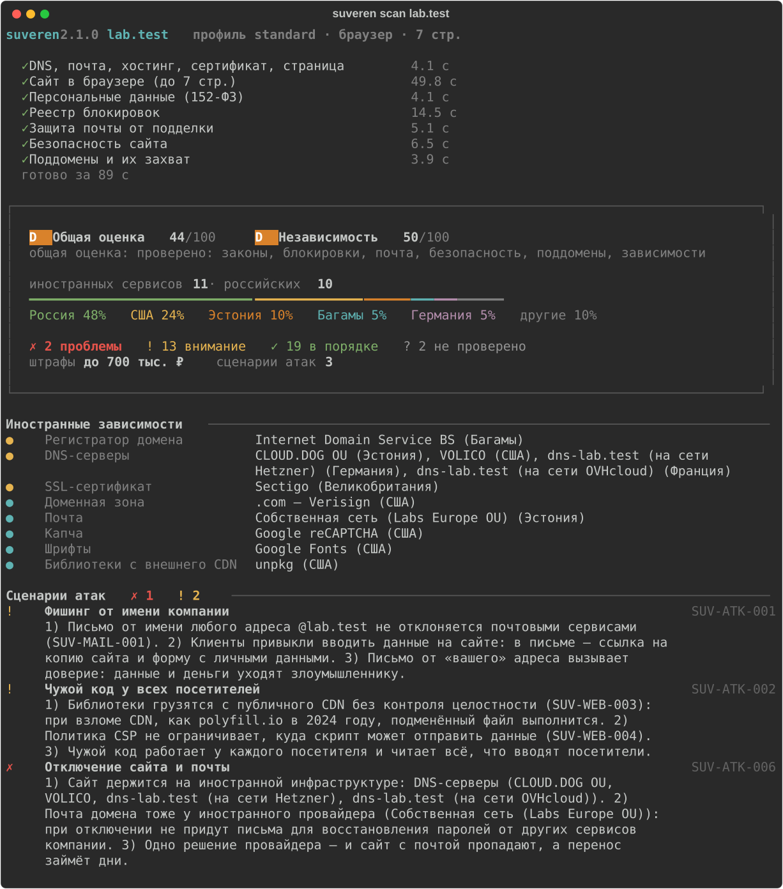

<div class="hero" markdown>


# Проверка сайта и компании для работы в России

[Скачать для Windows](https://github.com/marsilid/suveren/releases/latest){ .md-button .md-button--primary }
[Исходный код](https://github.com/marsilid/suveren){ .md-button }

</div>

Suveren проверяет сайт по требованиям российского законодательства и по признакам, которые
видны снаружи: DNS, почтовые записи, страницы, сертификат, сторонние скрипты. Результат
сохраняется в отчёт с доказательством для каждой находки: DNS-записью, заголовком ответа,
фрагментом политики, адресом скрипта. Для нарушений 152-ФЗ указаны статья закона и диапазон
штрафа по КоАП.

Проверка выполняется на компьютере пользователя. Результаты никуда не отправляются.



## Установка

**Windows.** `Suveren.exe` со страницы
[последнего релиза](https://github.com/marsilid/suveren/releases/latest). Установка и Python
не нужны, при запуске открывается меню.

**Linux, macOS, Windows** с Python 3.11 и новее:

```bash
pip install "suveren[browser]"
suveren scan example.ru
```

Сборка из исходного кода и Docker описаны в [руководстве](guide.md).

## Разделы проверки

| Раздел | Что проверяется |
|---|---|
| Персональные данные | политика обработки и её содержание, согласие в формах, отдельное согласие, уведомление о cookies, трансграничная передача, расположение серверов, реестр операторов ПДн. [Подробнее](check-152fz.md) |
| Другие требования законов | вход через иностранные сервисы (149-ФЗ), рекомендательные технологии, маркировка рекламы, ссылки на Instagram и Facebook |
| Защита почты | SPF, DKIM, DMARC, MTA-STS, длина ключей DKIM, итог: можно ли отправить письмо от имени домена. [Подробнее](email-spoofing.md) |
| Иностранные зависимости | DNS, почта, хостинг, CDN, конструктор сайта, регистратор, сертификат, скрипты и виджеты; оценка от A до F |
| Блокировки | домен, IP-адреса и сторонние сервисы в реестре блокировок Роскомнадзора |
| Безопасность сайта | заголовки безопасности, TLS, cookies, уязвимые библиотеки, ключи в коде, CAA, DNSSEC, поддомены, которые можно захватить |
| Компания | ЕГРЮЛ, санкционные списки США, ЕС, Великобритании и ООН, перечень Росфинмониторинга |

Всего около 70 проверок с постоянными идентификаторами. Полный список с описанием того, что
каждая проверка делает с сайтом: [Проверки](checks.md).

## Отчёт

HTML-отчёт сохраняется в папку `reports` и открывается в браузере. Дополнительно доступны PDF,
DOCX, JSON, SARIF, сводка на одну страницу, для списка сайтов также CSV.


## Воздействие на проверяемый сайт

По умолчанию Suveren обращается к сайту так же, как обычный посетитель: открывает главную и до
шести внутренних страниц, читает публичные DNS-записи и открытые реестры. Сканирования портов и
подбора паролей нет. Проверки, которые выходят за рамки обычного посещения, доступны только
для своего сайта после подтверждения владения (`suveren verify`).

## Ограничения

Отчёт не является юридическим заключением. Suveren видит сайт снаружи и не знает о договорах
компании, внутренних системах и поданных уведомлениях. Если проверку выполнить не удалось, она
получает статус «не проверено». Подробно об ограничениях и точности: [руководство](guide.md),
[точность проверок](accuracy.md).

## Чем отличается от онлайн-проверок

Онлайн-сервисы проверки по 152-ФЗ (например, SaitScan.ru и rffz.ru) удобны:
ничего не нужно ставить, а за плату часто дают шаблоны документов и консультацию юриста.
Suveren устроен иначе:

| | Suveren | Онлайн-сервисы по 152-ФЗ |
|---|---|---|
| Где работает | на вашем компьютере или в CI | на сервере сервиса |
| Код | открыт (AGPL), видно, как устроена каждая проверка | не опубликован |
| Цена | бесплатно, без регистрации | краткая сводка бесплатно, подробный отчёт за плату |
| Что проверяет | 152-ФЗ, а также иностранные зависимости (DNS, почта, хостинг, CDN), подделка писем (SPF, DKIM, DMARC), реестр блокировок, безопасность сайта, компания в ЕГРЮЛ и санкционных списках | в основном 152-ФЗ: документы, формы, cookies, сторонние скрипты, где стоит сервер |
| Для команды | JSON, SARIF, `--fail-on` для CI, проверка списка сайтов | отчёт на сайте сервиса |
| Точность | у каждой проверки постоянный ID, ответы сверены на [полигоне](accuracy.md) | методика обычно не опубликована |

Чего у Suveren нет: консультации юриста. Черновики политики и согласия он составляет по тому,
что нашёл на сайте, но их нужно дописать и показать юристу. Отчёт не является юридическим
заключением.

## О проекте писали

- [Статья автора на Хабре](https://habr.com/ru/articles/1105240/) о том, как устроен Suveren и что он проверяет.
- [Новость на Anti-Malware.ru](https://www.anti-malware.ru/news/2026-11-09-111332/51972), 9 ноября 2026.

## Обратная связь

Ошибки в проверках и предложения принимаются в
[issues](https://github.com/marsilid/suveren/issues) и
[обсуждениях](https://github.com/marsilid/suveren/discussions) на GitHub.
